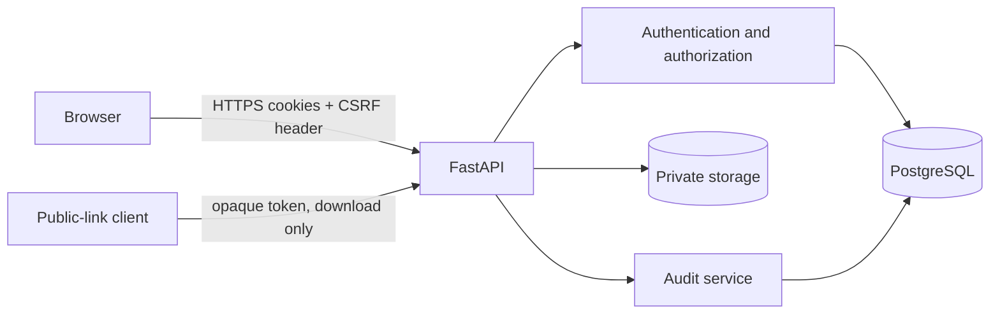

# Architecture

## Components

The same FastAPI origin serves a static HTML/CSS/JavaScript interface and the API. Pydantic validates structured bodies. SQLAlchemy 2.x maps `User`, `BrowserSession`, `Document`, `DocumentShare`, `ShareLink`, and `AuditEvent`. PostgreSQL is the production configuration; SQLite supplies portable tests.

## Trust boundaries

1. **Browser/application:** all cookies, headers, IDs, filenames, MIME claims, and body data are untrusted.
2. **Application/database:** only ORM-bound values cross; database credentials remain configuration.
3. **Application/storage:** only application-generated keys are joined to the fixed storage root.
4. **Anonymous public link/application:** possession grants only download while the server-side link row is active and unexpired.

## Flows

- **Registration:** signed anonymous CSRF check → schema/password policy → Argon2id → unique user → audit.
- **Login/session:** rate limit → generic verification → 256-bit token → HMAC persisted → HttpOnly cookie → bound CSRF rotation. Every protected request resolves the HMAC row, active user, revocation, and expiration.
- **Upload:** authenticate → CSRF → bounded read → decoded filename/extension/MIME/signature/structure validation → random key → exclusive private write → metadata/audit transaction. A database failure removes the written file.
- **View/download:** authenticate → lookup → centralized owner/active-share decision → derive generated-key path → existence check → audit → `FileResponse`.
- **Delete:** owner check → atomically rename file to quarantine → metadata/audit commit → unlink quarantine. A transaction error restores the file.
- **User share:** owner check on every create/list/revoke call → recipient lookup → create/reactivate or revoke unique row.
- **Public link:** owner creates random token; only HMAC persists and raw URL is returned once. Public GET hashes token, checks revocation/expiry, then reads/audits.

## Data and deletion

Foreign keys protect core relationships. Document shares and links are dependents deleted with documents. User deletion is not exposed. Audit `actor_user_id` uses `SET NULL`; its document/target IDs are intentionally historical scalar identifiers so audit evidence survives resource deletion. Timestamps are naive UTC for cross-dialect consistency.

## Operational characteristics

Alembic owns schema creation. Compose waits for PostgreSQL health, then performs a bounded connection check and migration. Storage mode is set to `0700` and files to `0600` where supported. Multiple application replicas require shared rate limiting and shared private object storage, neither included in this single-instance scope.
